# Suite EdNum - Éducation Numérique (Webapps & Ressources)


## 🎯 Présentation du projet

Bienvenue dans la **Suite EdNum**, un projet développé par l'Animation Pédagogique Éducation Numérique (HEP-VS).

Ce dépôt regroupe des **applications web interactives** (webapps) et des **outils pédagogiques**, sans publicité, et créés spécifiquement pour accompagner l'enseignement de la science informatique à l'école primaire (en complément des manuels valaisans et vaudois [Décodage](https://decodage.edu-vd.ch/)).

La philosophie pédagogique repose sur des interfaces épurées, une progression adaptative, de la gamification et une utilisation garantie **100% hors-ligne** pour permettre aux élèves et aux enseignant·e·s de se concentrer sur l'apprentissage.

---

## 🍎 Pour les enseignant·e·s (Utilisation simple)

Ces outils sont conçus pour fonctionner de la manière la plus simple possible, directement dans le navigateur (Chrome, Firefox, Safari, Edge) de votre ordinateur de classe ou de votre tablette.

### ✨ Les avantages pour votre classe
*   **Zéro installation :** Pas de serveur, pas de logiciel lourd. Téléchargez le dossier, double-cliquez sur `index.html` et c'est parti !
*   **100% Hors-ligne :** Une fois la page ouverte (ou installée comme application sur tablette), vous n'avez plus besoin d'internet. Parfait pour les écoles avec une connexion instable.
*   **Essayez tout de suite :** Toutes nos applications sont directement jouables en ligne sur le portail [www.ednum.org](https://www.ednum.org).

### 📦 Installation via npm (pour les responsables informatiques)

Si Node.js (≥ 18) is installé sur votre machine, vous pouvez lancer la suite directement avec une seule commande — sans téléchargement manuel ni serveur à configurer :

```bash
npx @ednum/suite-ednum
```

Cela démarre automatiquement un serveur local et ouvre le portail dans votre navigateur sur `http://localhost:3000`.

> **Port personnalisé :** `PORT=8080 npx @ednum/suite-ednum`
> **Sans ouverture automatique du navigateur :** `npx @ednum/suite-ednum --no-open`


### 📱 Compatibilité Multi-Supports (Responsive Design)
Nos applications sont pensées pour s'adapter à toutes les tailles d'écran (Mobile, Tablette, Desktop, et Ecrans larges). L'interface reste claire et utilisable sur tous les supports.

Voici un exemple avec le simulateur d'automate, prouvant la compatibilité sur de multiples supports :

| Mobile | Écran large (Wide) |
|:---:|:---:|
| 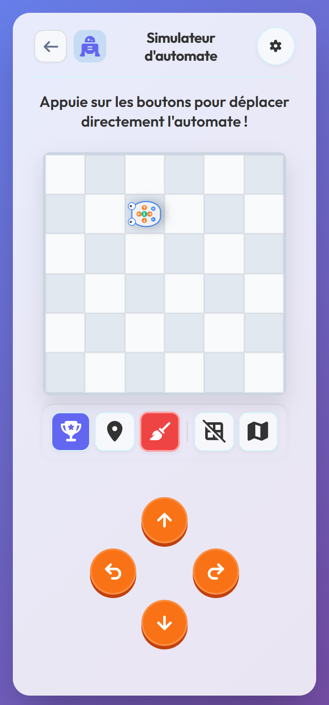 | 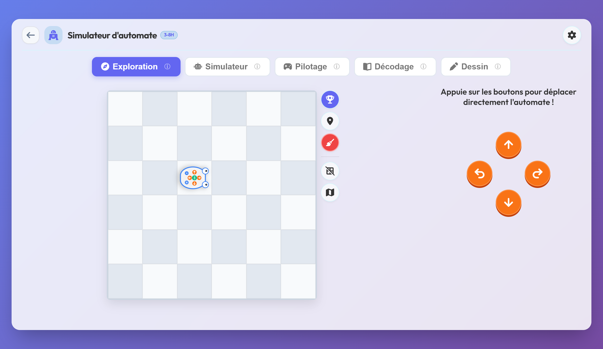 |
| *Affichage vertical compact* | *Exploitation complète de la largeur d'écran* |

### 🎮 Nos Webapps pour les élèves (Jeux pédagogiques)

Toutes nos applications intègrent une interface unifiée (design "Glassmorphism" moderne), un mode clair/sombre/contraste élevé, une difficulté adaptative intelligente, et des graphiques circulaires pour visualiser les progrès. L'application portail d'accueil (`index.html`) permet un accès facile et rapide à chaque outil. Pour les plus jeunes (4-7 ans, Cycle 1), un portail simplifié est également disponible (`indexC1.html`). Les activités sont classées par ordre de progression scolaire (1-4H jusqu'à 9-11CO).

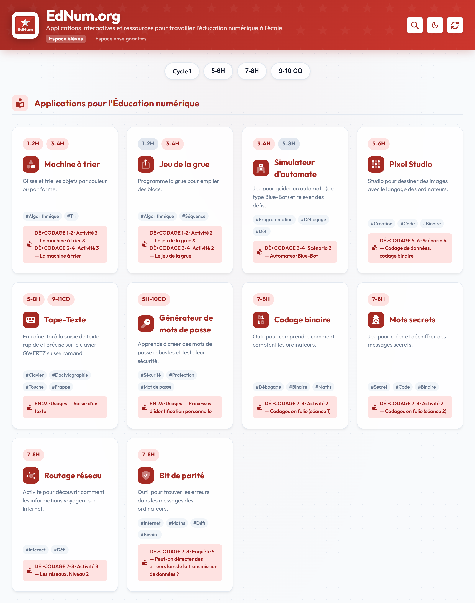

#### 1. Machine à trier (`webapps/machine_a_trier.html` - 1-2H & 3-4H)
- **À quoi sert l'outil :** Initiation aux algorithmes de tri et à la classification logique d'objets selon divers critères (forme, couleur, taille, quantité) via une bande transporteuse et des bacs récepteurs. [Mode d'emploi détaillé](meta/tuto/MODE_EMPLOI_MACHINE_A_TRIER.md).
- **Lien DÉ>CODAGE :** [3-4e](https://decodage.edu-vd.ch/3-4/) · Tri et classification (Demi-cycle 3-4H).
- **Fonctionnalités :** 2 modes (*Classique* et *Usine* avec tapis roulant interactif), 3 niveaux de difficulté (Facile, Moyen, Difficile) et rétroaction immédiate.
- **Valeur pédagogique :** Développe la catégorisation d'éléments, la discrimination visuelle et l'assimilation des règles algorithmiques de tri sans écran individuel requis pour les plus jeunes.

#### 2. Jeu de la grue (`webapps/jeu_de_la_grue.html` - 3-4H)
- **À quoi sert l'outil :** Initiation à la programmation séquentielle avec une grue mécanique déplaçant des cubes de couleur vers un objectif cible. [Mode d'emploi détaillé](meta/tuto/MODE_EMPLOI_JEU_DE_LA_GRUE.md).
- **Lien DÉ>CODAGE :** [3-4e](https://decodage.edu-vd.ch/3-4/) · **Scénario 2 — Automates** (Demi-cycle 3-4H).
- **Fonctionnalités :** Interface épurée avec 3 commandes simples (Gauche, Action attraper/poser, Droite), ruban d'instructions modifiable, exécution pas à pas et 3 niveaux de difficulté (1 à 3 cubes).
- **Valeur pédagogique :** Travaille la décomposition d'un déplacement en suite d'instructions simples, l'anticipation d'états (bras plein / bras vide) et la résolution pas à pas.

#### 3. Simulateur Automate (`webapps/simulateur_automate.html` - 3-4H, 5-8H)
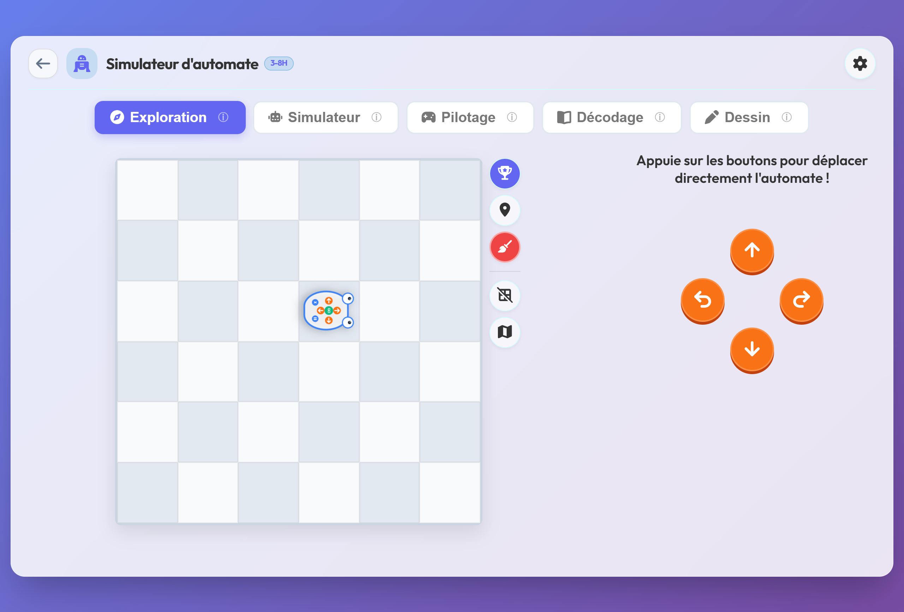
- **À quoi sert l'outil :** Un simulateur de robot programmable permettant aux élèves de découvrir les bases de la robotique et de la pensée algorithmique à travers des parcours libres et des puzzles de cheminement dynamiques. [Mode d'emploi détaillé](meta/tuto/MODE_EMPLOI_SIMULATEUR_AUTOMATE.md) | [Tutoriel de partage](meta/tuto/MODE_EMPLOI_PARTAGE.md).
- **Lien DÉ>CODAGE :** [3-4e](https://decodage.edu-vd.ch/3-4/) · **Scénario 2 — Automates · Automate** (Demi-cycle 3-4H)
- **Fonctionnalités :** 5 modes principaux (*Exploration*, *Simulateur*, *Pilotage*, *Décodage*, et *Dessin*). Explorez librement le robot, résolvez des puzzles avec règles strictes (Facile, Moyen, Difficile, Extrême), prédisez les parcours et trouvez des bugs. Utilisez les modes interactifs *Chasse aux paires* ou *Épeler* sur des tapis spécifiques pour récolter des paires ou former des mots. Créez aussi vos propres défis.
- **Valeur pédagogique :** Travaille la pensée algorithmique, la décomposition de problèmes, la décentration cognitive (droite/gauche relatives au robot) et favorise l'anticipation par la programmation à l'aveugle.

#### 4. Pixel Studio (`webapps/binaire_studio.html` - 5-6H)
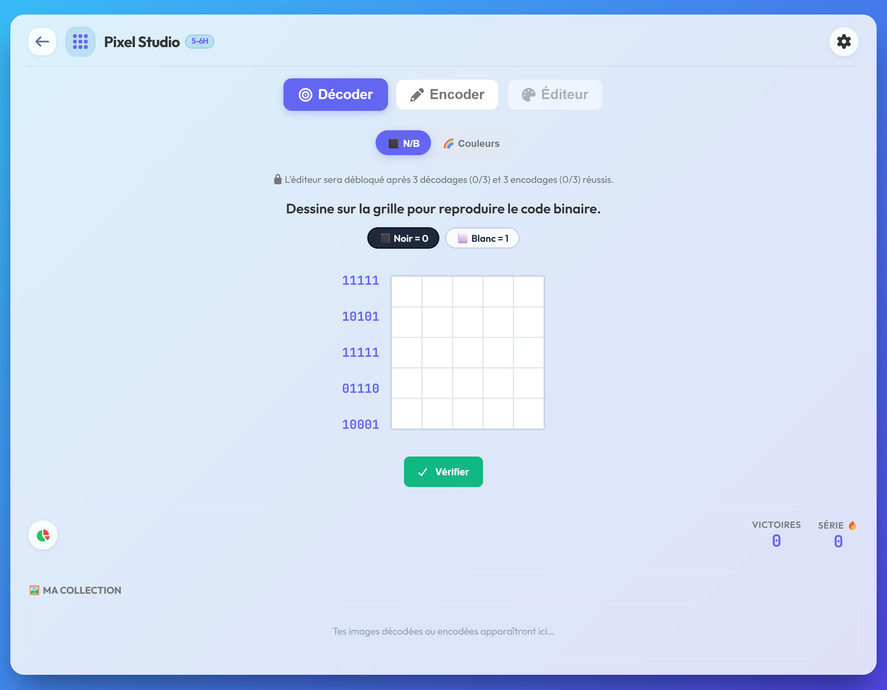
- **À quoi sert l'outil :** Un studio de codage interactif faisant le lien entre des images matricielles (en noir et blanc ou en 4 couleurs) et leur représentation binaire (1 ou 2 bits par pixel). [Mode d'emploi détaillé](meta/tuto/MODE_EMPLOI_PIXEL_STUDIO.md).
- **Lien DÉ>CODAGE :** [5-6e](https://decodage.edu-vd.ch/5-6/) · **Scénario 4 — Codage de données, codage binaire** (Demi-cycle 5-6H)
- **Fonctionnalités :** 3 modes : *Décoder* (dessiner d'après le code), *Encoder* (trouver le code d'une image) et *Éditeur Libre*. Propose un suivi des scores sur les modes *Décoder* et *Encoder*, un basculement instantané entre le mode Noir & Blanc (1 bit) et le mode Couleurs (2 bits : noir `00`, vert `01`, bleu `10`, jaune `11`), export PNG et partage par URL.
- **Valeur pédagogique :** Matérialise le concept abstrait de "numérisation". Comprendre que l'information visuelle (pixels) se traduit en séquences binaires de 0 et de 1.

#### 5. Tape-Texte (`webapps/dactylo.html` - 5-8H, 9-11CO)
- **À quoi sert l'outil :** Entraînement progressif à la frappe rapide et fluide sur clavier physique avec disposition suisse romande et suisse allemande (QWERTZ). [Mode d'emploi détaillé](meta/tuto/MODE_EMPLOI_DACTYLO.md).
- **Lien PER & Lehrplan 21 :** Cycle 2 & Cycle 3 (dès 5H jusqu'au secondaire I / 11CO).
- **Fonctionnalités :** 10 niveaux pédagogiques progressifs adaptés à la Suisse (phrases types, cédilles et accents, caractères spéciaux `LEVELS_DE` en allemand), clavier virtuel d'aide visuelle en cas d'erreur, analyse en temps réel (précision %, vitesse MPM/WPM, touches à travailler) et bilan élève exportable en PNG.
- **Valeur pédagogique :** Développe les automatismes moteurs de saisie sans regarder le clavier, renforce l'autonomie sur ordinateur de classe et prépare aux exigences des cycles 2 et 3.

#### 6. Générateur de mots de passe (`webapps/generateur_mot_de_passe.html` - 5H-10CO)
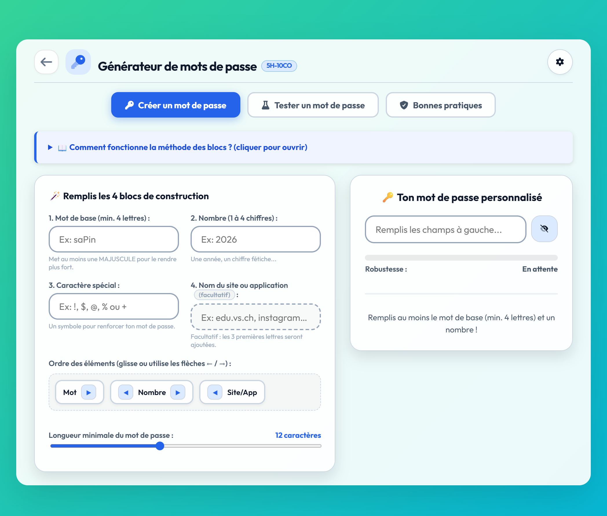
- **À quoi sert l'outil :** Création et audit interactif de mots de passe robustes (briques de construction, mot de passe magique, détection de motifs, estimation du temps de craquage et 4 règles d'or de cybersécurité). [Mode d'emploi détaillé](meta/tuto/MODE_EMPLOI_GENERATEUR_MOT_DE_PASSE.md).
- **Contexte & Utilisation :** Outil pratique pour aider les élèves (dès 5-6H) à concevoir et mémoriser un mot de passe sécurisé pour se connecter à leur environnement numérique de travail ([edu.vs.ch](https://edu.vs.ch)).
- **Valeur pédagogique :** Sensibilise à la cyberhygiène, à l'importance de la longueur et de la complexité face aux attaques par force brute ou dictionnaires.

#### 7. Codage binaire (`webapps/binaire_codage.html` - 7-8H)
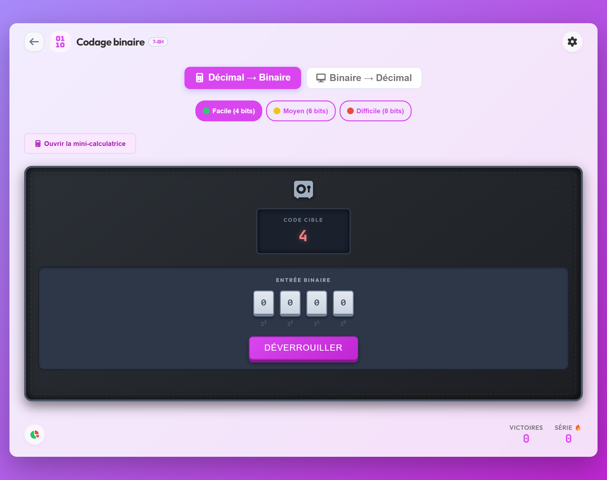
- **À quoi sert l'outil :** Entraînement intensif au passage des nombres entiers (décimal) vers le binaire, et inversement. [Mode d'emploi détaillé](meta/tuto/MODE_EMPLOI_CODAGE_BINAIRE.md).
- **Lien DÉ>CODAGE :** [7-8e](https://decodage.edu-vd.ch/7-8/) · **Activité 2 — Codages en folie (séance 1)** (Demi-cycle 7-8H)
- **Valeur pédagogique :** Consolide la numération de position sur 8 bits (jusqu'à 255) et guide l'élève de manière proactive et étayée (feedback "trop grand / trop petit").

#### 8. Mots secrets (`webapps/binaire_message.html` - 7-8H)
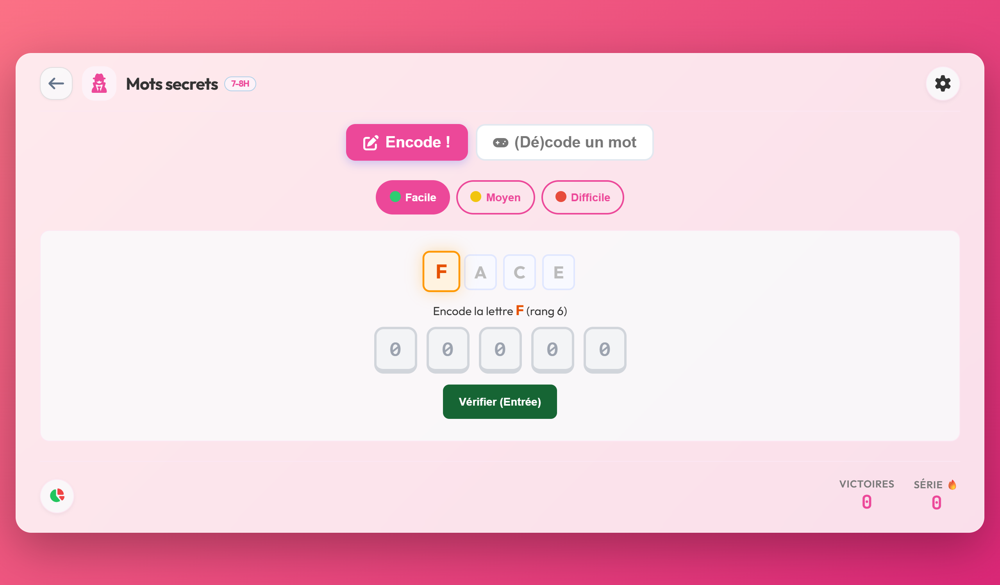
- **À quoi sert l'outil :** Un jeu interactif pour chiffrer et déchiffrer des mots en utilisant l'alphabet binaire. [Mode d'emploi détaillé](meta/tuto/MODE_EMPLOI_MOTS_SECRETS.md).
- **Lien DÉ>CODAGE :** [7-8e](https://decodage.edu-vd.ch/7-8/) · **Activité 2 — Codages en folie (séance 2)** (Demi-cycle 7-8H)
- **Fonctionnalités :** 2 modes principaux (*Encoder* un mot secret et *Décoder* un message secret), avec suivi des scores.
- **Valeur pédagogique :** Les élèves découvrent que les lettres sont représentées par des nombres, eux-mêmes encodés en binaire. Stimule le calcul mental (puissances de 2) et renforce la collaboration avec le mode (dé)codeur de messages.

#### 9. Routage Réseau (`webapps/routage_reseau.html` - 7-8H)
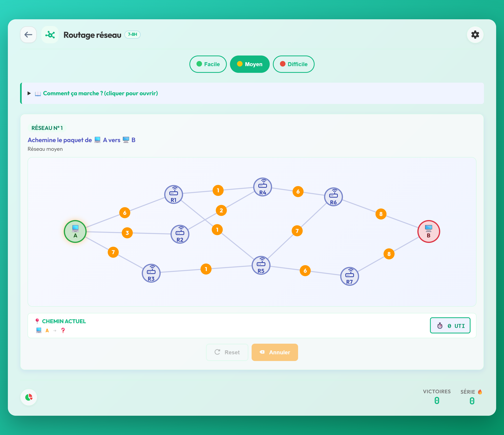
- **À quoi sert l'outil :** Simulation visuelle pour trouver le chemin le plus rapide pour acheminer un "paquet" dans un réseau. [Mode d'emploi détaillé](meta/tuto/MODE_EMPLOI_ROUTAGE_RESEAU.md).
- **Lien DÉ>CODAGE :** [7-8e](https://decodage.edu-vd.ch/7-8/) · **Activité 8 — Les réseaux, Niveau 2** (Demi-cycle 7-8H)
- **Valeur pédagogique :** Montre qu'un chemin court "visuellement" n'est pas le plus rapide (coût des routes). Sensibilise à l'infrastructure d'Internet et développe des stratégies d'optimisation face à des graphes complexes.

#### 10. Bit de Parité (`webapps/bit_de_parite.html` - 7-8H)
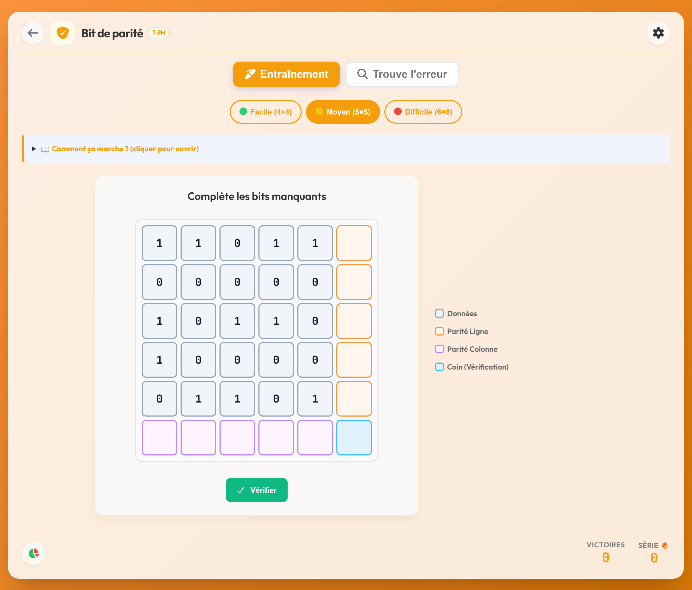
- **À quoi sert l'outil :** Jeu sur la parité (paire) permettant de comprendre comment l'ordinateur détecte qu'un message a été altéré. [Mode d'emploi détaillé](meta/tuto/MODE_EMPLOI_BIT_DE_PARITE.md).
- **Lien DÉ>CODAGE :** [7-8e](https://decodage.edu-vd.ch/7-8/) · **Enquête 5 — Peut-on détecter des erreurs... ?** (Demi-cycle 7-8H)
- **Valeur pédagogique :** Initie à l'intégrité de la donnée via des métadonnées (le bit de parité) et développe le repérage spatial via des coordonnées sur une grille.

#### 🌐 Ressources externes partenaires
- **Totem** ([Ouvrir Totem](https://guillaumetschupp.com/outils/totem/app.html) - 7H-10CO) : Un faux test de personnalité ludique et surprenant pour aiguiser l'esprit critique des élèves face aux pièges ordinaires du web et à la collecte de données (bilingue FR/DE, 100% exécuté localement dans le navigateur).


### 🛠️ Ressources pratiques pour les enseignant·e·s
Trouvez ces outils dans le portail central `index.html` ou directement dans le dossier `webapps/teacher/`. [Mode d'emploi des outils enseignants](meta/tuto/MODE_EMPLOI_OUTILS_ENSEIGNANT.md).

#### Générateur de Barème (`webapps/teacher/bareme.html`)
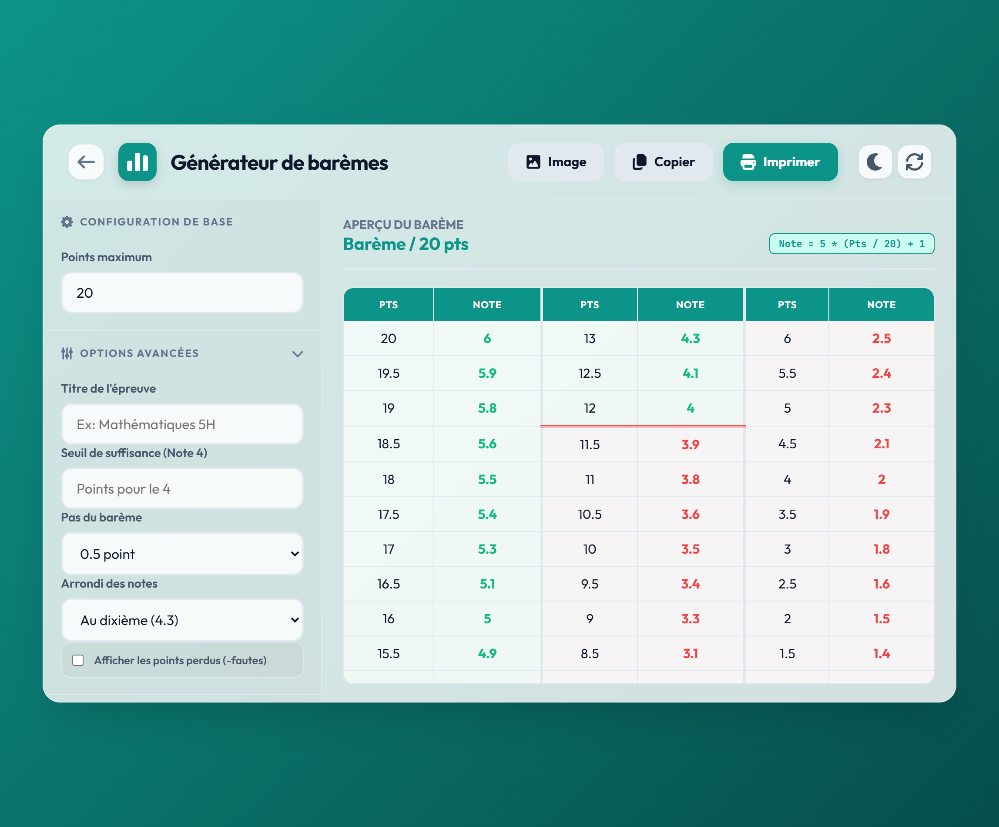
Un petit utilitaire sans publicité permettant de générer instantanément un barème de points pour la correction d'évaluations (avec option d'impression PDF au format propre). [Mode d'emploi détaillé](meta/tuto/MODE_EMPLOI_BAREME.md).

#### Tirage au Sort (`webapps/teacher/tirage.html`)
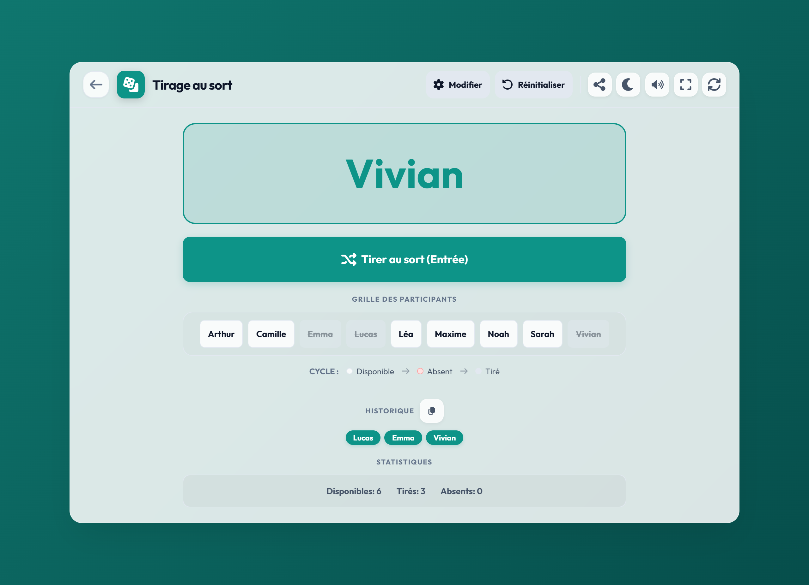
Outil visuel pour désigner un·e élève au hasard. Gère l'importation de listes de classe (XLS/XLSX, CSV, ENT) et l'exportation, la sauvegarde automatique (`localStorage`), l'exclusion d'élèves (absents) et conserve l'historique des tirages. [Mode d'emploi détaillé](meta/tuto/MODE_EMPLOI_TIRAGE_AU_SORT.md).

#### Roue de la chance (`webapps/teacher/roue_de_la_chance.html`)
Roue interactive personnalisable pour le tirage au sort en classe, l'attribution des rôles, les privilèges ou les questions d'éducation numérique. Gestion des listes personnelles (`localStorage`), présélections intégrées, générateur 1 à N et mode plein écran adapté aux TBI/TNI. [Mode d'emploi détaillé](meta/tuto/MODE_EMPLOI_ROUE_DE_LA_CHANCE.md).

#### Créateur de QR codes (`webapps/teacher/qrcode.html`)
Générateur sobre et rapide de QR codes pour la classe (liens, textes, Wi-Fi, fiches et planches imprimables, projection TBI, téléchargement HD et copie presse-papier). [Mode d'emploi détaillé](meta/tuto/MODE_EMPLOI_QRCODE.md).

#### Minuteur visuel (Time-Timer) (`webapps/teacher/time_timer.html`)
Compte à rebours visuel de 60 minutes avec disque coloré paramétrable, réglage fluide au glisser-déposer, raccourcis d'activités prédéfinis, carillons sonores (Web Audio API sans ressource externe) et modes plein écran / projection TBI pour structurer le temps en classe. [Mode d'emploi détaillé](meta/tuto/MODE_EMPLOI_TIME_TIMER.md).

#### Adaptateur & Simulateur DYS (`webapps/teacher/sim_dyslexie.html`)
Boîte à outils d'adaptation de textes scolaires (espacement Zorzi, coloration CERAS, syllabes bicolores, lettres muettes grisées, polices adaptées comme OpenDyslexic ou Century Gothic, profils enregistrables, export Word .docx et impression A4) et simulateur de sensibilisation cognitive aux difficultés de lecture. [Mode d'emploi détaillé](meta/tuto/MODE_EMPLOI_SIMULATEUR_DYSLEXIE.md).

### 🧪 Applications en avant-première (Dossier `alpha/`)
- 🔒 **Coffre-fort numérique** (`alpha/webapps/coffre_fort.html`, 3-6H) : [Mode d'emploi](meta/tuto/MODE_EMPLOI_COFFRE_FORT.md)
- 🔀 **Réseau de tri** (`alpha/webapps/reseau_de_tri.html`, 5-6H) : [Mode d'emploi](meta/tuto/MODE_EMPLOI_RESEAU_DE_TRI.md)
- 🔐 **Machine à chiffrer (César, Vigenère, Morse)** (`alpha/webapps/machine_a_chiffrer.html`, 7-8H) : [Mode d'emploi](meta/tuto/MODE_EMPLOI_MACHINE_A_CHIFFRER.md)
- ⚡ **Compresseur magique (RLE)** (`alpha/webapps/compresseur_magique.html`, 7-8H) : [Mode d'emploi](meta/tuto/MODE_EMPLOI_COMPRESSEUR_MAGIQUE.md)
- 🧠 **Dresseur de neurones & Détective IA** (`alpha/webapps/dresseur_de_neurones.html`, 7-8H) : [Mode d'emploi](meta/tuto/MODE_EMPLOI_IA_ET_NEURONES.md)
- 💻 **Pseudo-code** (`alpha/webapps/apprendre_pseudocode.html`, 9CO) : [Mode d'emploi](meta/tuto/MODE_EMPLOI_PSEUDOCODE.md)
- 🃏 **Une chose après l'autre (Tri par insertion)** (`alpha/webapps/tri_insertion.html`, 10CO) : [Mode d'emploi](meta/tuto/MODE_EMPLOI_TRI_INSERTION.md)
- 🛡️ **Anonymiseur de textes** (`alpha/webapps/teacher/anonymiseur.html`, Enseignant) : [Mode d'emploi](meta/tuto/MODE_EMPLOI_ANONYMISEUR.md)


---

## 💻 For Developers and Contributors

Do you like clean, lean, and extremely performant code? This project is for you.
We have made the radical choice of **100% Vanilla**. No React, no Tailwind, no npm install to compile production. The source code *is* the production code.

### 🏗️ Technical Architecture
*   **Stack:** HTML / CSS (Native Variables) / JS (ES6).
*   **Offline-First & PWA:** A robust Service Worker (`sw.js`) pre-caches all assets and HTML files using a Stale-While-Revalidate strategy. The cache manifest and a SHA-256 cache-busting hash are auto-generated by `node meta/scripts/generate-sw-manifest.js`. An update notification prompts users to reload when a new version is available.
*   **Shared Design System:** All Glassmorphism, Dark Mode, and UI components (`.btn`, `.tabs`, `.card`) are split across four CSS files loaded in parallel: `assets/css/tokens.css` (design tokens & variables), `assets/css/base.css` (resets & typography), `assets/css/components.css` (reusable components), and `assets/css/utilities.css` (helper classes).
*   **Global Managers:**
    *   Scores and Gamification: `assets/js/scores.js` (ScoreManager).
    *   Sounds (Web Audio API): `assets/js/audio.js` (no external .mp3 files).
    *   Toasts & Particles: `assets/js/toast.js` and `assets/js/confetti.js`.
    *   Class Roster Importer: `assets/js/roster-import.js` (Swiss ENT/ISM, Excel, CSV, TSV).
*   **Vector Icons (FontAwesome):** We use **FontAwesome 7 Pro (Solid & Duotone)**. Instead of loading a huge font file, a Node.js script (`meta/scripts/generate_fa_subset.js`) parses the HTML and dynamically generates `assets/js/fa-subset.js` (under 20kb!).

### 🤝 How to contribute?
Contributions (new apps, bug fixes, or UI optimizations) are highly appreciated!
Check out the **[Contributing Guide](CONTRIBUTING.md)** to learn more.

1.  **Fork** the project and clone your repo.
2.  Create a branch (`feature/new-app`).
3.  Make your changes while respecting the **Project Patterns** (see `meta/memory/code-patterns.md`).
4.  Run the unit and E2E tests before submitting.
5.  Open a **Pull Request** to `main`.

### 🧪 Testing
Our CI pipeline checks every PR. We use Node.js for unit tests and Playwright (Python) for E2E tests.

To run tests locally:
```bash
# 1. Unit Tests (Node.js)
npm run test:unit

# 2. E2E Tests (Playwright/Python)
python3 -m pip install -r meta/tests/e2e/requirements.txt && playwright install
python3 -m http.server 8000 > server.log 2>&1 &
sleep 5
python3 -m pytest meta/tests/e2e/
kill $(lsof -t -i :8000) 2>/dev/null || true
```
*   **Security:** A `_headers` file must exist in the root configuring HSTS (`Strict-Transport-Security`) for static deployments to enforce HTTPS.
*   **Experimental Features:** Alpha-stage applications are hosted under the `alpha/webapps/` directory.

## 📜 Changelog and Internal Documentation
Our entire development process (architecture decisions, logs) is archived in the `meta/memory/` folder. If you modify the global architecture, remember to update `project-context.md` or `event-log.md`.

## 📬 Contact / Support
For any pedagogical or technical questions, you can contact me:
📧 **vivian.epiney [at] hepvs.ch**

## ⚖️ Licences & Mentions Légales
Ce projet s'inscrit pleinement dans la philosophie des biens communs numériques éducatifs et du logiciel libre :
*   **Code source :** 100% du code source est distribué sous licence **[AGPL-3.0](https://www.gnu.org/licenses/agpl-3.0.html)** (GNU Affero General Public License v3). Partagez, modifiez, mais gardez le code libre !
*   **Contenus didactiques & pédagogiques :** Les documentations, modes d'emploi, tutoriels et défis pédagogiques sont mis à disposition sous licence **[CC BY-SA 4.0](https://creativecommons.org/licenses/by-sa/4.0/deed.fr)** (Creative Commons Attribution – Partage dans les Mêmes Conditions 4.0 International).
*   **Icônes :** Les icônes vectorielles proviennent de la suite **Font Awesome Pro** (Fonticons, Inc.), utilisées sous licence commerciale d'utilisation pour le projet.
*   **Pages d'information légale :**
    *   [Mentions légales](mentions-legales.html)
    *   [Politique de confidentialité & Données élèves](confidentialite.html)
    *   [Conditions générales d'utilisation (CGU)](cgu.html)
