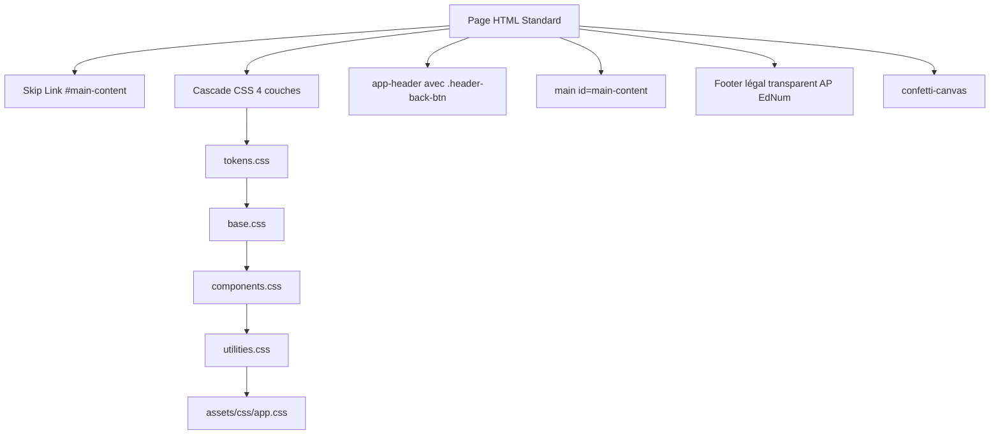

# 📋 Rapport d'Audit Global — Suite EdNum (v2.1.0)

**Date de l'audit :** 29 octobre 2026  
**Périmètre :** 31 pages HTML, 24 fichiers JavaScript métier, 14 feuilles CSS, Service Worker & CLI  
**Statut global de la suite :** 🟢 **Excellente santé générale** — Architecture vanilla exemplaire, 100% offline, 264/264 tests unitaires au vert, 0 dépendance de runtime.

---

## 📊 Tableau de Synthèse Exécutif

| Axe d'Audit | Score / Conformité | Statut | Synthèse |
| :--- | :---: | :---: | :--- |
| **Sécurité & CSP** | 92% | 🟡 Vigilance | Strict CSP `default-src 'self'` partout, 0 CDN, 0 eval, 0 inline event, mais **119 affectations `.innerHTML`** à migrer. |
| **Architecture & Squelette** | 98% | 🟢 Conforme | 100% AGPL-3.0, 100% footers légaux standardisés, cascade CSS 4 couches respectée à 100%. |
| **PWA & Offline** | 95% | 🟢 Conforme | Service Worker synchrone (79 assets, Stale-While-Revalidate), 100% `pwa.js` et `link[rel="root"]`. |
| **Performance** | 94% | 🟢 Conforme | 0 console.log, chargement sans bundler, 2 tapis robotiques d'automate à optimiser en WebP. |
| **Accessibilité (WCAG AA)** | 97% | 🟢 Conforme | 100% de `<h1>` uniques, 100% des images avec `alt`, boutons accessibles, mode Contraste Élevé natif. |
| **i18n & Suisse Standard (de-CH)** | 96% | 🟢 Conforme | **0 caractère `ß`** (100% conforme règle suisse), 452 clés `de.js`, Lot 1 élèves complété. |
| **Qualité & Conventions** | 88% | 🟡 À harmoniser | 264/264 tests passants, 791 single-line `if` sans accolades `{}` et 102 `...` non typographiques. |

---

## 1. 🔒 Sécurité & Politiques de Contenu (CSP / XSS)

### 1.1 Points Forts
- **Content-Security-Policy (CSP) :** Déclaré sur **100% des pages (31/31)** avec la directive stricte `default-src 'self'`. Aucune fuite de données ni appel réseau tiers possible.
- **Zéro CDN externe :** Aucune ressource distante (script, police, CSS, audio, image) n'est importée. L'autonomie 100% locale en classe est garantie.
- **Zéro `eval` et zéro constructeur dynamique :** Aucun usage d'évaluation de code non sécurisée dans le code applicatif.
- **Zéro écouteur inline :** Aucun attribut `onclick="..."`, `onchange="..."` dans les balises HTML. Tous les événements passent par `addEventListener` ou la délégation.
- **Protection Directory Traversal dans le CLI (`bin/ednum.js`) :** La résolution du chemin racine vérifie `SECURE_ROOT` avec séparateur terminal, bloquant toute tentative d'évasion par `..`.
- **Moteur de désinfection i18n (`assets/js/i18n.js`) :** La méthode `setSanitizedHtml` utilise `DOMParser.parseFromString` avec liste blanche stricte de balises (`STRONG`, `EM`, `B`, `I`, `SPAN`, `BR`, `P`, `A`) et validation des liens contre `javascript:`.

### 1.2 Points d'Attention & Recommandations

> [!WARNING]
> **Usage résiduel de `.innerHTML = <valeur>` (119 occurrences)**  
> Conformément à la directive d'architecture `decisions.md` (sécurisation Google VICE / CodeQL), les assignations directes à `.innerHTML` doivent être remplacées par `textContent`, `createElement` ou `DOMParser`.

- **Production (32 occurrences) :**
  - `webapps/binaire_codage.html` (8 occurrences) : zone de feedback et calculatrice binaire.
  - `webapps/binaire_message.html` (7 occurrences) : rendu dynamique de la grille de décodage.
  - `webapps/routage_reseau.html` (6 occurrences) : messages de bilan d'itinéraire et icônes routeurs.
  - `webapps/teacher/bareme.html` (4 occurrences) : construction du tableau de barème.
  - `webapps/teacher/time_timer.html` (4 occurrences) : bascule d'icônes FontAwesome dans les boutons de test.
  - `webapps/teacher/roue_de_la_chance.html` (2 occurrences) : historique des tirages.
  - `webapps/bit_de_parite.html` (1 occurrence) : bulle d'aide contextuelle.
- **Alpha (87 occurrences) :**
  - Fortes concentrations dans `apprendre_pseudocode.html` (20), `dresseur_neurones.html` (15), `dactylo.html` (13), `sim_dyslexie.html` (12).
- **Vider le DOM :** 74 occurrences de `.innerHTML = ''` gagnent à être uniformisées avec `element.textContent = ''` ou `element.replaceChildren()`.
- **En-têtes HTTP CLI (`bin/ednum.js`) :** Ajouter `X-Content-Type-Options: nosniff` et `X-Frame-Options: SAMEORIGIN` dans la réponse HTTP pour compléter le HSTS déjà actif.

---

## 2. 🏛️ Architecture & Squelette Standard

### 2.1 Synthèse de Conformité du Squelette
- **En-tête de licence AGPL-3.0 :** **31/31 (100%)** ✅
- **Cascade CSS (tokens → base → components → utilities) :** **31/31 (100%)** ✅
- **Footer réglementaire standardisé (HEP-VS, Vivian Epiney, merci, mentions, confidentialité, CGU) :** **31/31 (100%)** ✅
- **Bouton retour `.header-back-btn` :** Présent sur toutes les webapps (29/29), omis à juste titre uniquement sur les deux portails racine `index.html` et `indexC1.html` ✅
- **Retour Enseignants (`index.html#teachers`) :** Respecté sur 100% des outils maîtres (`webapps/teacher/*` et `alpha/webapps/teacher/*`) ✅
- **Registre des applications (`assets/js/registry.js`) :** 49 entrées, **0 lien brisé**, 100% des webapps du disque indexées ✅

### 2.2 Écarts Notables Détectés
- **Skip-Link manquant :** `webapps/teacher/roue_de_la_chance.html` ne possède pas de `<a href="#main-content" class="skip-link">`, et sa balise `<main>` n'a pas l'attribut `id="main-content"`.
- **Pages légales racines :** `merci.html`, `mentions-legales.html`, `confidentialite.html`, `cgu.html` pourraient également recevoir le skip-link pour une accessibilité clavier sans faille.

---

## 3. 📱 PWA, Service Worker & Mode Hors-Ligne

### 3.1 Validation du Service Worker
- **Synchronisation du Manifest :** Vérification `npm run check:sw` passée avec succès : **79 assets audités et synchronisés** sous la version de cache `ednum-a8d84d60`.
- **Intégration du script `pwa.js` :** **31/31 pages (100%)** chargent `pwa.js`.
- **Balise de racine `<link rel="root" href="...">` :** **31/31 pages (100%)** intègrent le lien relatif vers la racine permettant au script d'enregistrer `sw.js` de manière transparente depuis n'importe quel niveau d'arborescence.
- **Stratégie de mise en cache :** Modèle *Stale-While-Revalidate* performant avec mise à jour automatique sans coupure pour les élèves et notification par toast discret.

### 3.2 Recommandation PWA
- **Manifest sur les sous-pages :** Actuellement, seuls `index.html` et `indexC1.html` déclarent `<link rel="manifest" href="manifest.json">` et `<meta name="theme-color" content="#a52a23">`.  
  *Bénéfice :* Ajouter ces deux balises dans `<head>` de chaque webapp permettra aux enseignants et élèves d'installer un outil spécifique (ex. *Minuteur visuel* ou *Simulateur Automate*) directement comme PWA autonome depuis sa propre URL.

---

## 4. ⚡ Performance & Optimisation des Médias

### 4.1 Métriques & Assets
- **Empreinte de runtime :** 0 framework lourd (React/Vue/Angular), 0 bundler, exécution directe par le moteur du navigateur.
- **Console logs résiduels :** **0 `console.log`** dans tout le code de production (vérifié dans l'ensemble des JS et HTML).
- **Polices système optimisées :** `Outfit` et `JetBrains Mono` servies localement en WOFF2 avec `font-display: swap`.
- **FontAwesome sur-mesure :** Utilisation d'un fichier SVG/JS subset minimaliste (`assets/js/fa-subset.js`) au lieu de la police complète FontAwesome de 3 Mo.

### 4.2 Optimisation Recommandée des Images

| Fichier | Taille Actuelle | Potentiel WebP Optimisé | Gain Estimé |
| :--- | :---: | :---: | :---: |
| `assets/img/mats/city.webp` | **781.5 KB** | ~180 KB | -75% |
| `assets/img/mats/valais.webp` | **334.2 KB** | ~120 KB | -64% |

Une compression sans perte visuelle de ces deux tapis d'arrière-plan de l'Automate permettra d'alléger le premier téléchargement hors-ligne de ~800 KB sur les connexions d'école.

---

## 5. ♿ Accessibilité (a11y) & Ergonomie TBI

### 5.1 Bilan WCAG AA
- **Hiérarchie des titres :** **31/31 pages (100%)** ont un titre `<h1>` unique et sémantique.
- **Images texturées :** **100% des balises ``** disposent d'un attribut `alt` descriptif.
- **Boutons iconiques :** Aucun bouton muet. Les boutons utilisent soit du texte visible, soit un `aria-label`, soit `data-i18n-attr` pour les lecteurs d'écran.
- **Ergonomie tactile (Tablet-First) :** 
  - Règle CSS `button { min-width: 44px; min-height: 44px; }` dans `base.css`.
  - Suppression du délai de tapotement de 300ms via `touch-action: manipulation`.
  - Règle anti-zoom Safari iOS : `font-size: 16px !important` sur les champs de saisie pour viewports ≤ 1024px.
- **Mode Haute Lisibilité :** Classe `body.high-contrast` basculable avec contrastes noirs/blancs tranchés, anneaux de focus renforcés (`outline: 3px solid #667eea; outline-offset: 2px`) et suppression des transparences glassmorphism.
- **Mode TBI (Tableau Blanc Interactif) :** Support de la projection grand écran sans débordement sur les outils de classe.

---

## 6. 🌐 Internationalisation (i18n) & Spécificités Suisses (de-CH)

### 6.1 Conformité Suisse Alémanique (de-CH)
- **Règle de l'Eszett (`ß`) :** **Zéro caractère `ß`** dans l'intégralité des dictionnaires `assets/js/i18n/de.js` et des interfaces (les seules occurrences trouvées dans le dépôt proviennent de la table codepage de la bibliothèque tierce `xlsx.full.min.js` et de la documentation du projet).
- **Terminologie scolaire suisse :** Utilisation scrupuleuse des termes *Zyklus 1-3*, *Primar*, *OS*, *Lehrplan 21*.
- **Moteur i18n synchrone :** Aucun appel `fetch()` asynchrone, exécution garantie sous le protocole `file://` en local.

### 6.2 Couverture des Traductions
- **Dictionnaire `assets/js/i18n/de.js` :** ~452 clés actives couvrant :
  - Les composants transverses (`theme`, `pwa`, `scores`, `modal_export`, `url_params`).
  - Les portails `index.html` et `indexC1.html`.
  - Le Lot 1 des applications élèves (6 applications complétées : `binaire_codage`, `binaire_message`, `binaire_studio`, `bit_de_parite`, `generateur_mot_de_passe`, `routage_reseau`, `simulateur_automate`).
- **Prochaines étapes prévues par la feuille de route :** Étendre l'intégration i18n aux 5 outils enseignants de production puis aux applications du dossier `alpha/`.

---

## 7. 🧪 Qualité du Code, Tests & Conventions

### 7.1 Validation des Tests Automatisés
- **Tests unitaires (`npm run test:unit`) :** **264 tests exécutés, 264 réussis, 0 échec** (durée : ~15.7s).
- Couverture testée : Moteur d'anonymisation, audio WebAudio/fallback, encodage binaire, confetti/célébrations, dactylographie/clavier virtuel, time_timer, tirage au sort (import ENT XLSX/CSV), toasts, paramètres URL.

### 7.2 Écarts aux Règles de Style Détectés
- **Accolades `{}` sur structures de contrôle :** 791 blocs `if` écrits sur une seule ligne sans accolades (ex. `if (!el) return;`), principalement dans `automate-ui.js`, `automate-engine.js`, `time_timer.html`, `binaire_studio.html`.  
  *Règle du projet :* Toujours encadrer les blocs de contrôle avec `{}` pour prévenir les erreurs de maintenance.
- **Points de suspension typographiques :** 102 occurrences du caractère classique trois points `...` au lieu de l'ellipse typographique `…` dans des messages textuels.

---

## 🎯 Plan d'Action Recommandé (Roadmap de Remédiation)

### Priorité 1 (Sécurité & Accessibilité Immédiate)
1. **Élimination de `.innerHTML` en production (Lot Prioritaire) :**
   Remplacer les 32 assignations directes dans `webapps/binaire_codage.html`, `binaire_message.html`, `routage_reseau.html`, `bareme.html`, `time_timer.html`, `roue_de_la_chance.html` et `bit_de_parite.html` par `textContent`, `createElement` ou `replaceChildren`.
2. **Conformité Skip-Link Roue de la Chance :**
   Ajouter le skip-link et l'attribut `id="main-content"` dans `webapps/teacher/roue_de_la_chance.html`.
3. **Hardening HTTP CLI :**
   Ajouter `X-Content-Type-Options: nosniff` et `X-Frame-Options: SAMEORIGIN` dans `bin/ednum.js`.

### Priorité 2 (Performance & Expérience PWA)
4. **Optimisation des tapis d'automate :**
   Recompresser `assets/img/mats/city.webp` et `assets/img/mats/valais.webp` pour économiser ~800 KB de pré-cache.
5. **Généralisation du lien Manifest PWA :**
   Déployer `<link rel="manifest" href="../../manifest.json">` et `<meta name="theme-color" content="#a52a23">` sur l'ensemble des 25 webapps.

### Priorité 3 (Harmonisation & Déploiement i18n continu)
6. **Harmonisation syntaxique :**
   Formater progressivement les blocs `if` sans accolades lors des prochaines interventions ciblées.
7. **Poursuite du déploiement i18n :**
   Câbler `i18n.js` sur les 5 outils enseignants (`bareme.html`, `tirage.html`, `qrcode.html`, `time_timer.html`, `roue_de_la_chance.html`).

